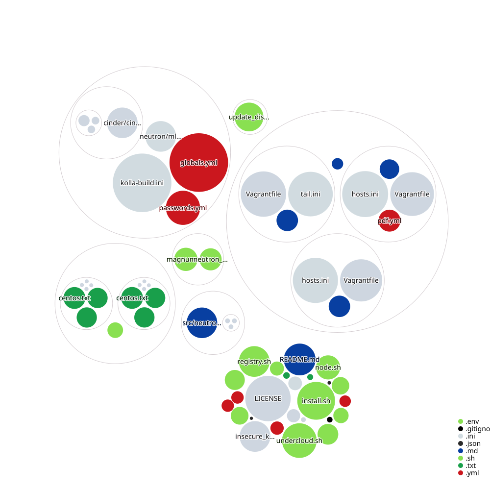

# OpenStack Multi-Node Deployment

<!-- markdown-link-check-disable-next-line -->

<!-- markdown-link-check-disable-next-line -->

This repository provides Vagrant-based environments and deployment scripts
for testing OpenStack with [Kolla-Ansible][1].
The examples cover a single-node deployment, a no-HA cluster, and a
distributed topology.
They are intended for development and testing, not as production reference
architectures.

## Deployment examples

- [All-in-one](docs/sample-aio.md): run the OpenStack services on one VM.
- [No high availability](docs/sample-noha.md): run a controller and compute
  nodes, using Vagrant or physical Raspberry Pi hardware.
- [Distributed](docs/sample-distributed.md): provision a multi-VM topology
  with separate controller, compute, storage, registry, and monitoring roles.

For prerequisites, setup guidance, and networking references, start at the
[documentation index](docs/index.md).

The deployment scripts prepare nodes, configure Kolla-Ansible, and optionally
build and publish container images to a local registry.
See [install.sh](install.sh), [node.sh](node.sh), and
[registry.sh](registry.sh) for the implementation.

## Contributing

Contributions are welcome, including code, documentation, testing, and
community outreach.

[1]: https://docs.openstack.org/kolla-ansible/latest/
