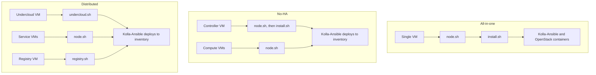
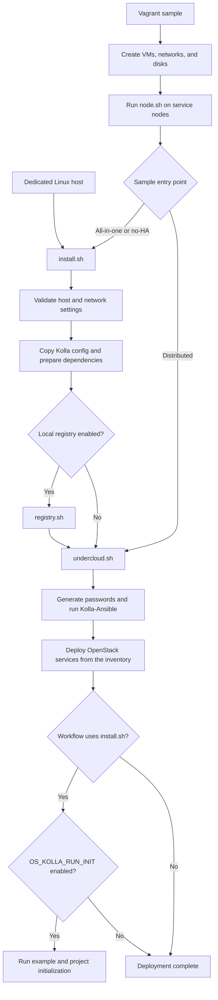

# How the deployment works

This project connects virtual-machine provisioning, host preparation, and
Kolla-Ansible into repeatable OpenStack development and test environments.
Vagrant defines the machines and networks; shell scripts prepare the hosts;
Kolla-Ansible deploys OpenStack services as containers.

The project does not replace Kolla-Ansible.
It supplies sample topologies, host setup, inventories, and configuration
around the upstream deployment tool.

## Sample topologies

The three Vagrant samples differ mainly in where the deployment tools run
and how many service nodes they manage:

In the distributed sample, Vagrant provisions service nodes separately from
the undercloud.
In the all-in-one and no-HA samples, `install.sh` runs from the service VM
that also acts as the deployment host.
The [sample guides](index.html#choose-a-deployment) describe each topology in
more detail.

## Deployment components

### Vagrant environments

The Vagrant configurations under `samples/` declare VM resources, networks,
disks, and provisioning commands.
They mount the repository at `/vagrant` in each VM and invoke the same
deployment scripts used by the direct installation path.

The all-in-one sample runs the services and deployment tools in one VM.
The no-HA sample separates a controller from compute nodes.
The distributed sample uses an undercloud VM to deploy services to separate
registry, controller/network, compute, storage, and monitoring nodes.
None of these samples provides production high availability.

### Host preparation

`node.sh` prepares each service node.
It can partition, format, and mount extra disks, configure Cinder LVM volumes,
and run a role-specific script such as `controller.sh` or `compute.sh`.
It then installs the node's operating-system dependencies.

The disk options can format the selected devices.
Only pass disposable disks to those options.

### Deployment host

`undercloud.sh` runs on the machine that manages the deployment.
It installs the dependencies for the selected OpenStack release and host
distribution, configures Ansible, applies `OS_KOLLA_` settings to
`/etc/kolla/globals.yml`, and runs Kolla-Ansible actions against the selected
inventory.

The default inventory is `samples/aio/hosts.ini`.
Set `OS_INVENTORY_FILE` to select another inventory, as the distributed
sample does.

### Configuration and credentials

The repository's `etc/kolla/` files are copied into `/etc/kolla/`.
Kolla-Ansible generates deployment credentials there and uses the global
configuration and service-specific overrides during deployment.
The generated administrator environment file is
`/etc/kolla/admin-openrc.sh`.

The repository keeps release-specific Python dependency files under
`requirements/<release>/`.
`OPENSTACK_RELEASE` selects the corresponding dependency set.
Use a release and operating-system combination for which this repository
provides a requirements file.

### Optional image registry

When `OS_ENABLE_LOCAL_REGISTRY=true`, the installer calls `registry.sh`
before deploying OpenStack.
The script configures a local registry, builds the selected Kolla images,
and attempts to copy upstream images for images that it could not build.
The deployment host is configured to use that registry.

## Deployment sequence

The entry point depends on the environment.
Vagrant provisions the sample machines before running the node and deployment
scripts; a direct installation starts with host validation.
Both paths prepare Kolla configuration before Kolla-Ansible deploys services.

The optional post-deployment initialization runs when the workflow uses
`install.sh` and `OS_KOLLA_RUN_INIT` is not set to `false`.
This includes the direct installer and the all-in-one and no-HA Vagrant
samples.
The distributed sample invokes `undercloud.sh` directly, so it does not run
that `install.sh` initialization phase.

## Boundaries

This repository's scripts can modify operating-system packages, network and
service configuration, disks, and `/etc/kolla` files.
The sample inventories and network layouts are examples for development and
testing.
Use the [upstream Kolla-Ansible documentation](https://docs.openstack.org/kolla-ansible/latest/)
and adapt the configuration and operations to your own environment before
using this project outside a disposable lab.

## Related documentation

- [Install and use OpenStack Multi-Node](installation.html).
- [Extend a deployment](extending.html).
- [Deployment samples](index.html#choose-a-deployment).
