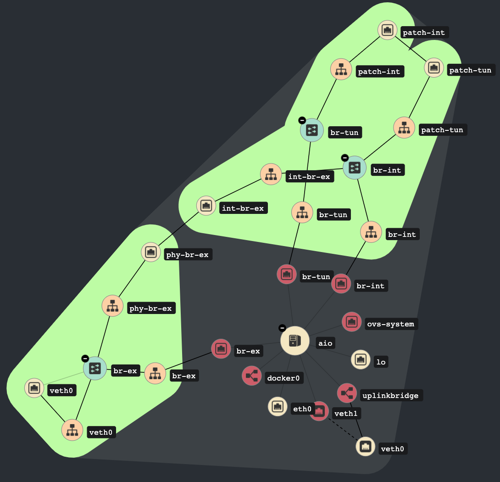

# All-in-one sample

The all-in-one sample provisions a single virtual machine for a development or
test deployment.
It uses the repository's Vagrant configuration and Kolla-Ansible installer.
It is not a production architecture.

## Prerequisites

- Vagrant and a supported provider: VirtualBox or libvirt.
- The provider's required plugins and host packages.
- Enough host resources for the VM. The default is 8 virtual CPUs and 16 GiB
  of memory.

The VM box is selected from `distros_supported.yml`.
The default distribution is `debian_12`; set `OS_DISTRO` to another supported
box key to select a different image.

## Start the VM

From the repository root, run:

```bash
cd samples/aio
vagrant up
```

Vagrant provisions the VM and runs the node and deployment scripts.
Set `CPU` or `MEMORY` before `vagrant up` to change the VM resources.
Other optional settings, including `OS_KOLLA_ENABLE_MAGNUM` and
`OS_KOLLA_RUN_INIT`, are passed through by the sample's Vagrant configuration.

See the [sample Vagrantfile](https://github.com/electrocucaracha/openstack-multinode/blob/master/samples/aio/Vagrantfile)
and [inventory](https://github.com/electrocucaracha/openstack-multinode/blob/master/samples/aio/hosts.ini)
for the values used by this environment.
For a manual or production deployment, follow the official
[Kolla-Ansible documentation](https://docs.openstack.org/kolla-ansible/latest/).


