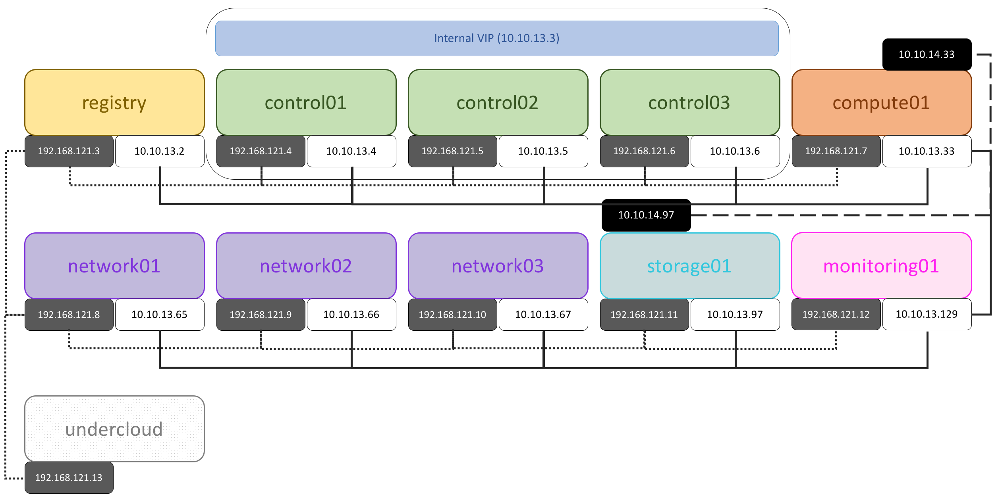

# Distributed sample

The distributed sample provisions seven service VMs with separate registry,
controller/network, compute, storage, and monitoring roles.
It also uses an undercloud VM as the deployment host.
This is a development and testing environment, not a production design.

## Host resources

The current topology is defined in
[the Vagrant data file](https://github.com/electrocucaracha/openstack-multinode/blob/master/samples/distributed/pdf.yml).
The seven service VMs each have one virtual CPU and 8 GiB of memory.
That is 56 GiB of memory for the service VMs, before the undercloud and host
overhead.
The registry VM has a 50 GiB volume, and the storage VM has a 100 GiB volume.

## Provision the environment

Install Vagrant and a supported provider, then run the following from the
repository root:

```bash
cd samples/distributed
vagrant up
vagrant up undercloud
```

The first command starts the service VMs.
The second starts the provisioning VM, which configures the inventory and
deploys OpenStack to the service nodes.
The distribution defaults to `ubuntu_22`; set `OS_DISTRO` to another supported
box key before starting the VMs to change it.

See [the sample Vagrantfile](https://github.com/electrocucaracha/openstack-multinode/blob/master/samples/distributed/Vagrantfile)
and [inventory](https://github.com/electrocucaracha/openstack-multinode/blob/master/samples/distributed/hosts.ini)
for the complete topology.


