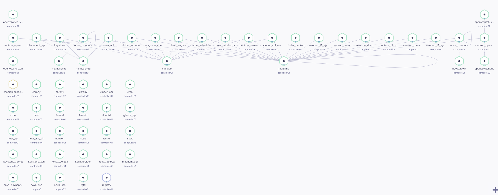

# No-HA sample

The no-high-availability (no-HA) sample provisions a controller and one or
more compute nodes.
It can run in Vagrant virtual machines or on physical systems.
The sample is intended for development and testing; it does not provide high
availability.

## Vagrant deployment

Install Vagrant and a supported provider, then run these commands from the
repository root:

```bash
cd samples/noha
VAGRANT_EXPERIMENTAL=disks vagrant up
vagrant up controller
```

The first command starts the compute nodes.
The second starts the controller, which can build images and run a local
registry before deploying OpenStack.
The default is two compute nodes; set `OS_NUM_COMPUTE_NODES` to change that
count.

The controller defaults to 4 virtual CPUs and 8 GiB of memory.
Each compute VM defaults to 4 GiB of memory.
Set `CPU` and `MEMORY` to adjust those resources.
The Vagrant configuration defaults to a local image registry; set
`OS_ENABLE_LOCAL_REGISTRY=false` to disable it.

## Physical deployment

For a bare-metal walkthrough, including inventory setup, management and
external network requirements, and verification steps, see
[Deploy no-HA OpenStack on Raspberry Pi 4](raspberry-pi-noha.html).
The guide describes a lab topology and explicitly calls out where its
assumptions differ from the Vagrant sample.

See the [sample Vagrantfile](https://github.com/electrocucaracha/openstack-multinode/blob/master/samples/noha/Vagrantfile)
and [inventory fragments](https://github.com/electrocucaracha/openstack-multinode/tree/master/samples/noha)
for the configuration used by the Vagrant environment.


